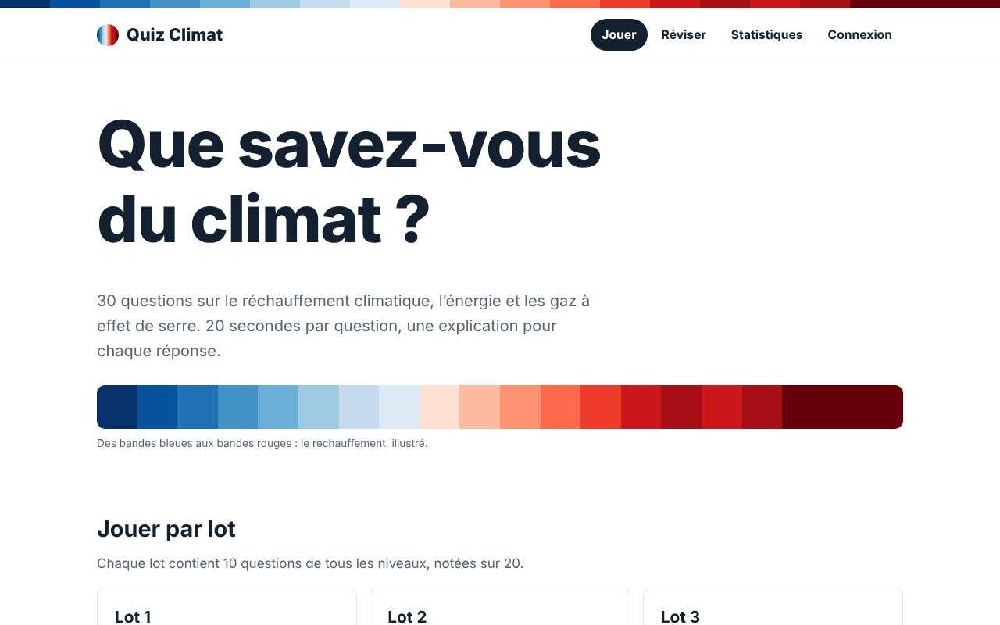
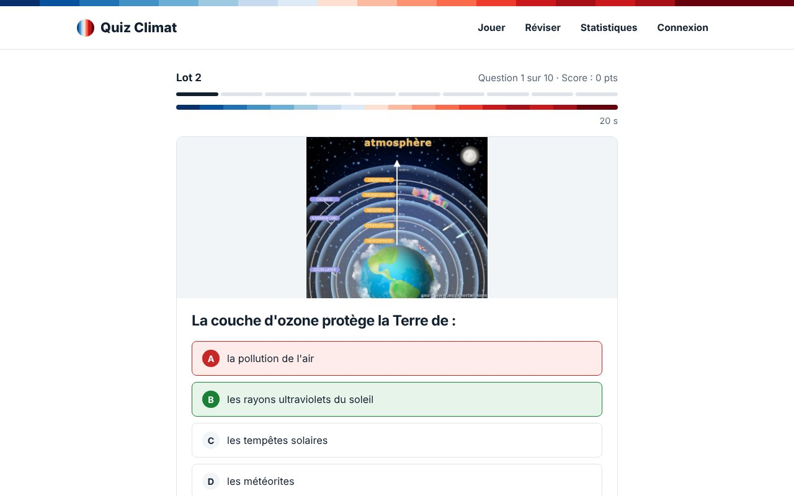

# Quiz Climat

Application web de quiz sur le climat, l'énergie et les gaz à effet de serre. Elle est réalisée en **HTML, CSS et JavaScript**, sans framework. Les questions sont chargées depuis un fichier **XML**.

**🔗 Jouer en ligne : https://hadi56a.github.io/climate-quiz-app/**



## Fonctionnalités

- **30 questions** réparties en 3 lots et 3 niveaux de difficulté (facile, moyen, difficile)
- **Minuteur** de 20 secondes par question, avec une barre de progression
- **Correction immédiate** : la bonne réponse s'affiche, avec un lien vers son explication
- **Page Réviser** : recherche (sans tenir compte des majuscules ni des accents), filtre par thème, tri et pagination
- **Fiche de chaque question** : réponse, thème, niveau, explication, et affichage personnalisable (taille et couleurs, enregistrés dans le navigateur)
- **Statistiques** : chiffres clés, histogramme dessiné avec l'API Canvas et historique des parties
- **Connexion** : identifiants vérifiés depuis un fichier XML, avec un mot de passe comparé sous forme d'empreinte SHA-1 (Web Crypto API)
- **Responsive** et accessible : navigation au clavier, contrastes, préférence « moins d'animations » respectée



## Points techniques

| Sujet | Mise en œuvre |
| --- | --- |
| Données | `data/questions.xml`, lu avec `fetch` et `DOMParser` |
| Affichage | Éléments créés avec l'API DOM (pas de `innerHTML`, donc pas de risque d'injection) |
| Stockage | `localStorage` pour les scores, le joueur connecté et les réglages d'affichage |
| Graphique | Histogramme dessiné à la main sur un `<canvas>`, net sur les écrans haute résolution |
| Code | Un fichier commun (`js/common.js`) et un script par page |

## Lancer le projet en local

Le site lit des fichiers XML : il doit donc être ouvert depuis un petit serveur, et non en double-cliquant sur `index.html`.

```bash
git clone https://github.com/hadi56a/climate-quiz-app.git
cd climate-quiz-app
python3 -m http.server 8000
```

Ouvrez ensuite http://localhost:8000 dans votre navigateur.

**Compte de démonstration** : identifiant `demo`, mot de passe `climat2024`.

> La connexion est une démonstration côté navigateur. Dans une vraie application, le mot de passe serait vérifié par un serveur, avec un algorithme de hachage adapté (bcrypt, Argon2).

## Structure

```
├── index.html             accueil : choix du lot ou du niveau
├── page/
│   ├── jeu.html           partie en cours
│   ├── reviser.html       liste des questions
│   ├── question.html      fiche d'une question
│   ├── statistiques.html  historique et graphique
│   └── connexion.html
├── css/style.css
├── js/                    common.js + un script par page
├── data/                  questions.xml, utilisateurs.xml
├── images/                illustrations des questions
└── docs/                  captures d'écran du README
```

## Auteur

Hadi Assi, projet réalisé en 2024 dans le cadre d'un cours de développement web (L2 Informatique, Université de Bretagne Occidentale).
